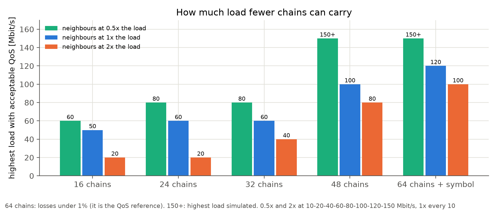
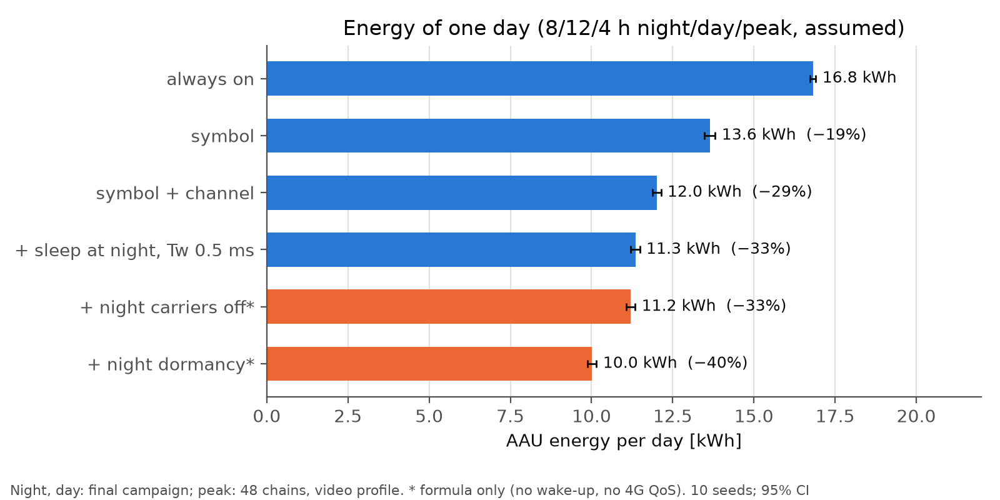
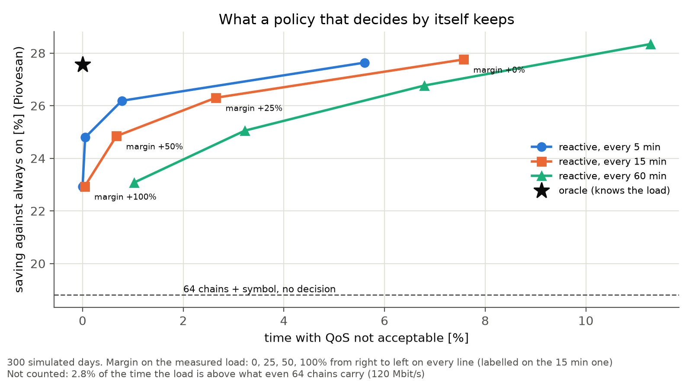
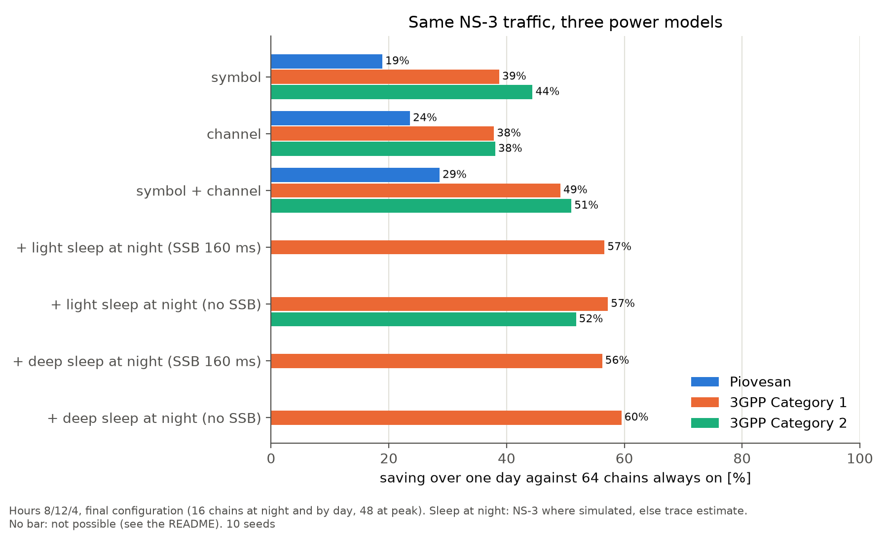

# 5G base station energy: NS-3 scenario and power model

How much energy can a 5G base station save by switching off parts of itself, and at what cost in
quality of service? An NS-3 + 5G-LENA scenario produces load and QoS; Python turns them into watts
with the AAU power model of Piovesan et al. (2022).

    NS-3 (C++) -> CSV per slot and per flow -> Python: metrics -> watts -> comparisons and figures

This page gives the scenario, the main results and how to set up. The full record of the work, step by
step, is in [docs/STEPS.md](docs/STEPS.md); every command to rerun it is in [docs/RUN.md](docs/RUN.md).

## Results

Energy saved over one day (8 h night, 12 h day, 4 h peak) against the same base station with everything always on.
The antenna has 64 elements, and each is driven by its own chain: the transmitter electronics and the power
amplifier behind that element. Every site picks how many chains to keep on from its own load.

| What is switched off | Saving per day | QoS cost |
|---|---|---|
| Power amplifiers in empty symbols (symbol shutdown) | 19% | none |
| + unused antenna chains: 16 of 64 kept at night and by day, 48 at peak | **29%** | at peak, 4 more users in 100 over 20 ms (limit: 5) |
| + sleep of the whole unit between bursts at night, 0.5 ms to wake up | 33% | none: night delays grow by 0.25 ms |
| Same, with a rule that picks the chains from the load measured every 5 min | 25% | QoS not acceptable 0.05% of the time |
| Same as the second row, with the 3GPP power model instead of Piovesan | 49% | as the second row |
| + light sleep of the whole unit at night (3GPP model) | 57% | none: night delays stay under 10 ms |

Energy efficiency, TDMA scheduling and the other studies are in [STEPS.md](docs/STEPS.md). All numbers rest on
the assumptions listed
[at the end](#main-assumptions-and-limits): the traffic levels, the hours per level, the 20 ms delay limit and the
relative QoS criterion.

## Method


**Scenario** (`ns-3.46.1/scratch/bs-energy.cc`). Three sites 500 m apart (cell radius 250 m), 10 users per site, urban
macro channel (3GPP UMa) with shadowing. Each site is one active antenna unit (AAU) with two contiguous
30 MHz carriers at 3.5 GHz (n78), TDD pattern DDDSU and a 64-element array; each element has its own transceiver
chain (digital-to-analogue converter, radio-frequency electronics and power amplifier). Only cell 0 is measured. In the
final study each neighbour picks its chains for its own load, which is the same as, half or twice that of cell 0;
in the earlier steps the neighbours kept 64 chains. Scheduling is proportional fair. SU-MIMO with two layers is on;
MU-MIMO is not available in 5G-LENA for the downlink. Each user is attached to its strongest site.

**Traffic.** Three levels, each simulated for 10 s after a 0.3 s warm-up, with 10 random seeds. A day is
8 h of night, 12 h of day and 4 h of peak. The final study also runs the day profile from 5 to 150 Mbit/s.

| Level | Offered traffic | Users |
|---|---|---|
| Night | 1 Mbit/s | 2 per site, rare Poisson bursts of 25 kB |
| Day | 40 Mbit/s | 10 per site, Poisson bursts |
| Peak | 100 Mbit/s | 3 video users (3, 10, 40 Mbit/s, as 2 s segments) + 7 burst users |

**Power model** (`analysis/lib/power.py`). Piovesan et al. (2022), normalised to a 930 W peak:

$$
P_{\mathrm{AAU}} = P_0 + P_{\mathrm{BB}} + M_{\mathrm{av}}\,D_{\mathrm{Tran}} + M_{\mathrm{ac}}\,D_{\mathrm{PA}} + \frac{1}{\eta}\sum_{c=1}^{C} P_{\mathrm{TX},c}
$$

where $P_0$ is the static power, $P_{\mathrm{BB}}$ the baseband, $M_{\mathrm{av}}$ and $M_{\mathrm{ac}}$ the available
and active transceiver chains, $D_{\mathrm{Tran}}$ and $D_{\mathrm{PA}}$ the power of one transceiver and of one
power amplifier (PA), $\eta$ the PA efficiency and $P_{\mathrm{TX},c}$ the transmitted power of carrier $c$
($C = 2$). $P_{\mathrm{TX},c}$ follows the simulated resource-block (PRB) load. The savings act on these terms:

- **Symbol shutdown**: the PAs sleep in downlink symbols that carry no data on either carrier, minus
  two transition symbols. One control symbol per slot always stays on.
- **Channel shutdown**: only 48, 32, 24 or 16 of the 64 transceiver chains stay active ($M_{\mathrm{ac}}$); the
  array shrinks in NS-3 too, so the loss of beamforming gain is simulated.
- **Sleep modes**: the whole AAU sleeps between bursts and needs a wake-up time; simulated in NS-3.

**QoS.** Per burst user, the 95th percentile (p95) of the packet delay, against a 20 ms limit. A
setting is acceptable if, compared to 64 chains on the same seeds, at most 5 more users in 100 exceed
the limit, no extra video segment arrives late (a segment needs 99% of its packets within 2 s) and
losses stay under 1%.

## Main results

**Fewer chains save most when the cell is quiet, and how far they go depends on the neighbours**
([steps 2](docs/STEPS.md#2-main-campaign-power-and-qos) and [13](docs/STEPS.md#13-final-study-every-cell-picks-its-own-chains)).
With 16 of 64 chains and symbol shutdown the power falls by about 32% at any load, but the QoS holds only up to
50 Mbit/s when the neighbours carry the same load (20 with neighbours twice as loaded, 60 with half). 48 chains
carry up to 100 Mbit/s, and above 120 the cell saturates even with 64. 32 chains are never worth it: they carry
the same load as 24.



*Data: final campaign `bs-results-indep`, 1890 runs, script `studies.final`. Day profile with 10 burst users per site
from 5 to 150 Mbit/s, plus the night; cell 0 at 64, 48, 32, 24 and 16 chains; each neighbour at 0.5, 1 or 2 times
the load of cell 0, with the chains the rule picks for its own load; OFDMA; 10 seeds, 20 for 64, 48 and 32 chains at
80-150 Mbit/s with neighbours at the same load.*

**Over a day: -28.6%, and -32.5% with sleep at night** ([steps 6](docs/STEPS.md#6-sleep-with-a-wake-up-time) and
[13](docs/STEPS.md#13-final-study-every-cell-picks-its-own-chains)), with 16 chains at night and by day and 48 at
peak. Sleeping between bursts at night with a 0.5 ms wake-up time adds about 18% at night, and the night delays
grow by only 0.25 ms. What moves the daily saving most is the number of peak hours.



*Data: night and day from the final campaign with neighbours at the same load as cell 0 (`bs-results-indep/x1`:
night at 1 Mbit/s and day at 40 Mbit/s, 64 and 16 chains). Peak: the profile with video at 100 Mbit/s, 64 and 48
chains (`bs-results-main` and `bs-results-grid`), whose neighbours keep 64 chains because the final campaign has no
video; neighbours that also save would only lower the interference. Sleep at night: `bs-results-wake`, 10 runs,
neighbours at 64 chains, which at 1 Mbit/s makes no difference. Orange bars: power formula only. OFDMA, 10 seeds.
Script `studies.final`.*

**A simple rule gets most of it without knowing the traffic**
([steps 11 and 13](docs/STEPS.md#13-final-study-every-cell-picks-its-own-chains)). Every 5 minutes it measures
the load, adds a 50% margin and keeps the fewest chains that sustain it: -24.8% against -27.6% for an oracle, with
the QoS unacceptable 0.05% of the time. Deciding every hour is too slow.



*Data: power and QoS per load and chains from the final campaign with neighbours at the same load as cell 0
(`bs-results-indep/x1`, 1090 runs), applied to 300 synthetic days of 5-minute loads (our 8/12/4 h levels with
one-hour ramps and a random fluctuation). Script `studies.policy --final`.*

**The power model matters as much as the technique** ([step 10](docs/STEPS.md#10-the-3gpp-power-model)). On the same
traffic and with the same choices, symbol and channel shutdown save 29% with Piovesan and 49-51% with the 3GPP
TR 38.864 model, and up to 60% with sleep at night. Symbol shutdown alone saves 19% with Piovesan and 39-44% with
3GPP: in 3GPP an empty symbol costs 20% of full load, in Piovesan 47%. Fewer chains alone save 24% with Piovesan and
38% with 3GPP. The 3GPP report does not say which of its two categories of values applies to real equipment. Two
older models, EARTH and Björnson, can each express only one of the two techniques; they are compared in
[step 5](docs/STEPS.md#5-other-power-models-earth-and-björnson).



*Data: the same runs as the day above (final campaign at night and by day, 48 chains at peak), through each power
model. Light and deep sleep at night: simulated in NS-3 for 3GPP Category 1 (`bs-results-wake3gpp`, neighbours at
64 chains, which at 1 Mbit/s makes no difference), estimated on the traces for Category 2. Script `studies.final`.*

*Missing bars cannot be computed. Piovesan has no light or deep sleep state, only the sleep with a 0.5 ms wake-up of
the day figure above. Category 2 of the 3GPP report takes 640 ms to go into light sleep and back, and 10 s for deep
sleep: light sleep does not fit between two SSBs 160 ms apart, and deep sleep is as long as the whole 10 s simulated,
so only light sleep without SSB can be estimated.*

### Two more findings

These come from the earlier configuration, with the neighbour sites always at 64 chains.

**The scheduler is an energy lever too** ([steps 8](docs/STEPS.md#8-tdma-against-ofdma) and
[9](docs/STEPS.md#9-why-tdma-serves-the-peak-better)). With TDMA instead of OFDMA each user gets the whole band for
a few symbols, so the slot ends early and the power amplifiers sleep more (31% of the time at peak instead of 24%).
At peak with 64 chains TDMA uses 3% less power and halves the burst users over 20 ms (8 to 4 of 70), with no late
video segment (2 with OFDMA). Fewer blocks fail their first transmission, mostly because the interference of TDMA
neighbours is flat across frequency.

**Sleep pays only when the night is really quiet** ([step 7](docs/STEPS.md#7-busier-nights)). Sleep with a 0.5 ms
wake-up adds 18% at night with 1 Mbit/s but 11% with 15 Mbit/s; with a 5 ms wake-up it falls from 17% to 4%. No user
goes over 20 ms in any case.

The rest of the work (calibrating the peak load, energy efficiency in bit/J, all sites with the same chains) is in
[STEPS.md](docs/STEPS.md). Steps 1-12 keep the neighbours at 64 chains (12: at the chains of cell 0); step 13
recomputes steps 2, 3, 10 and 11 with every site deciding for itself.

## Main assumptions and limits

- Only the AAU and the downlink are modelled. No MU-MIMO: 5G-LENA is limited to SU-MIMO in downlink, so
  64 chains lose their main advantage and the QoS cost of fewer chains is probably underestimated.
- Each run simulates 10 s of a traffic level, not hours. The traffic levels, the 8/12/4 h day, the 20 ms
  delay limit and the QoS criterion, and the video segments are assumptions.
- With Piovesan, sleep times come from a survey and sleep powers from Piovesan. The 3GPP model gives both
  from one source but leaves open which of its two categories applies.
- The QoS criterion is relative to 64 chains, and from about 90 Mbit/s 64 chains degrade too (11% of the burst
  users over 20 ms at 90 Mbit/s, 22% at 120). "Acceptable" means "not much worse than 64 chains".
- The final study uses burst users only. Its peak hours keep the earlier peak with video, with neighbours at 64
  chains, which is pessimistic for the QoS. The neighbours pick their chains with a fixed rule, more cautious than
  the limits measured, so those limits are lower bounds.
- The 16-chain limit at 50 Mbit/s sits exactly on the criterion (+5.0 ± 7.7 points, 10 seeds).
- The energy-efficiency, power-model and scheduler studies (steps 4, 5, 7-9) and sleep by day and at peak (step 6)
  use the earlier configuration, with neighbours at 64 chains; at night and by day the neighbours make no difference
  ([step 12](docs/STEPS.md#12-all-sites-with-fewer-chains)).
- Sleep with a wake-up time is implemented on the OFDMA scheduler only, so TDMA was not combined with it.
- With OFDMA, 18-25% of the blocks at peak fail their first transmission, above the usual 10% target:
  5G-LENA has no outer loop link adaptation. A simple one is available (`--ollaStep`, off) but made delay,
  losses and power much worse in a trial; all results are without it.
- The policy study takes a change of chains as instantaneous and free.
- With 10 seeds the QoS differences have wide intervals; the final study uses 20 at 80-150 Mbit/s for 64, 48 and
  32 chains.

## Contents

| Path | What it is |
|---|---|
| `ns-3.46.1/scratch/bs-energy.cc` | The NS-3 scenario (the rest of NS-3 is not in this repository) |
| `docker/` | Environment: `Dockerfile` and `setup.sh` |
| `run_campaign.sh`, `run_wakeup.sh` | Campaigns: traffic levels x chains x seeds; sleep with a wake-up time |
| `analysis/lib/` | Shared code: paths, figure style, NS-3 metrics, power models, campaign loading |
| `analysis/studies/` | One script per result |
| `analysis/tests/` | Checks of the power models against numbers stated in the papers |
| `analysis/figures/` | The figures, generated by the studies |
| `docs/` | The full record of the steps, and how to rerun everything |

Raw NS-3 outputs and generated CSV files are not in the repository.

## Setup

Requirements: Docker, git, Python 3.12, about 5 GB of free disk. Tested on an Apple M2 (arm64).

1. Get this repository, NS-3 3.46.1 and 5G-LENA v4.1.1 (the sources are unmodified):

   ```bash
   git clone https://github.com/FilizZPalm/5G-base-station-energy-NS-3-scenario-and-power-model.git
   cd 5G-base-station-energy-NS-3-scenario-and-power-model
   curl -LO https://www.nsnam.org/releases/ns-3.46.1.tar.bz2
   tar xjf ns-3.46.1.tar.bz2 -C ns-3.46.1 --strip-components=1
   git clone --branch v4.1.1 https://gitlab.com/cttc-lena/nr.git ns-3.46.1/contrib/nr
   ```

2. Build the image, create the `ns3-5g` container and compile (about 10 minutes; the image includes Eigen,
   which SU-MIMO needs):

   ```bash
   docker/setup.sh
   ```

3. Python environment:

   ```bash
   python3.12 -m venv .venv
   .venv/bin/pip install numpy==2.5.5 pandas==3.1.1 matplotlib==3.11.2
   ```

4. Main campaign (90 runs, about 1 hour) and main figures:

   ```bash
   OUT=bs-results-main ./run_campaign.sh
   cd analysis
   ../.venv/bin/python -m lib.campaign
   ../.venv/bin/python -m studies.plots
   ```

All other campaigns and studies: [docs/RUN.md](docs/RUN.md).
