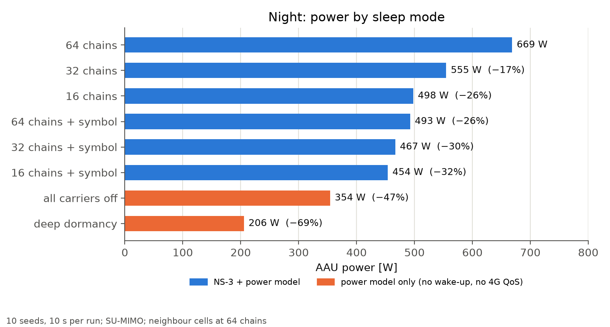
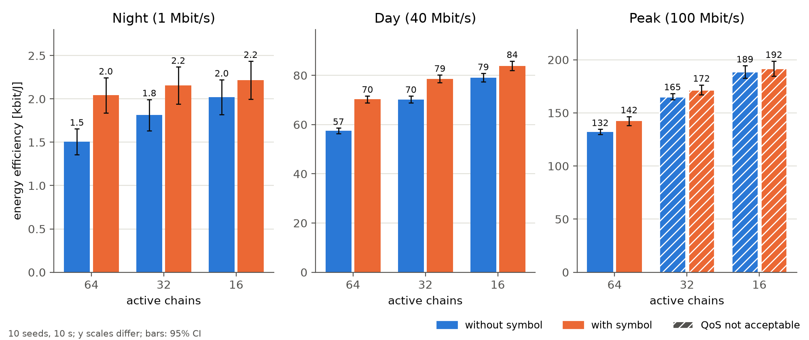
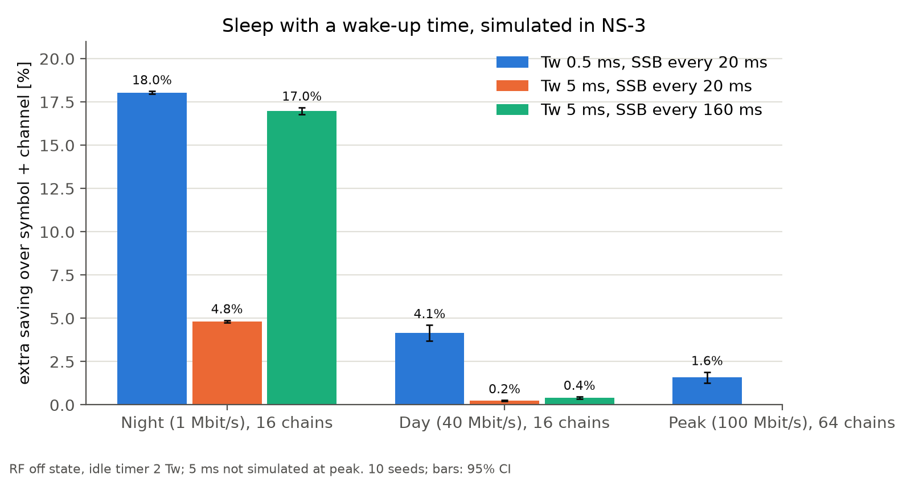
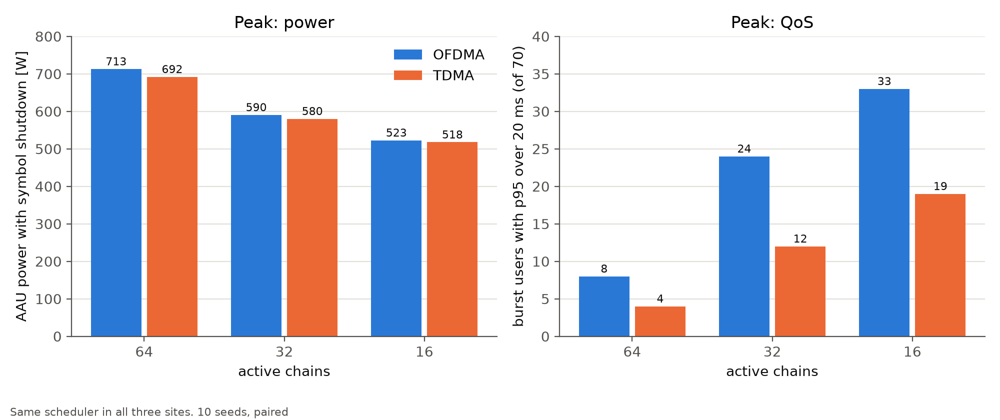

# 5G base station energy: NS-3 scenario and power model

How much energy can a 5G base station save by switching off parts of itself, and at what cost in
quality of service? An NS-3 + 5G-LENA scenario produces load and QoS; Python turns them into watts
with the AAU power model of Piovesan et al. (2022).

    NS-3 (C++) -> CSV per slot and per flow -> Python: metrics -> watts -> comparisons and figures

## Results at a glance

| Question | Answer (10 seeds, 95% CI where shown) |
|---|---|
| Saving over a day, symbol + channel shutdown | **-27.3 ± 0.4%** (16.83 -> 12.24 kWh) |
| ... adding a 0.5 ms sleep mode, simulated in NS-3 | **-32.9 ± 0.6%** (11.30 kWh) |
| Best setting per traffic level | night and day: 16 of 64 chains + symbol shutdown; peak: 64 chains + symbol |
| QoS cost | none at night and by day; at peak, fewer chains fail the QoS criterion |
| Energy efficiency over a day | 53.3 -> 73.3 kbit/J (+37%) |
| TDMA instead of OFDMA scheduling | about 1% less energy over a day, and fewer users over 20 ms at peak (8 -> 4 of 70) |
| Same traffic, 3GPP power model (TR 38.864) | symbol + channel **-48%**; with light sleep at night (SSB every 160 ms) **-55.5%** |

All of this rests on the assumptions listed [at the end](#main-assumptions-and-limits): the traffic
levels, the hours per level, the 20 ms delay limit and the pairing of sleep times with sleep powers.

## Method

**Scenario** (`ns-3.46.1/scratch/bs-energy.cc`). Three sites 500 m apart (cell radius 250 m), 10 users per site, urban
macro channel (3GPP UMa) with shadowing. Each site is one active antenna unit (AAU) with two contiguous
30 MHz carriers at 3.5 GHz (n78), TDD pattern DDDSU and a 64-element array. Only cell 0 is measured; its
neighbours always use 64 chains. Scheduling is proportional fair. SU-MIMO with two layers is on;
MU-MIMO is not available in 5G-LENA for the downlink. Each user is attached to its strongest site.

**Traffic.** Three levels, each simulated for 10 s after a 0.3 s warm-up, with 10 random seeds:

| Level | Offered traffic | Users |
|---|---|---|
| Night | 1 Mbit/s | 2 per site, rare Poisson bursts of 25 kB |
| Day | 40 Mbit/s | 10 per site, Poisson bursts |
| Peak | 100 Mbit/s | 3 video users (3, 10, 40 Mbit/s, as 2 s segments) + 7 burst users |

A day is 8 h of night, 12 h of day and 4 h of peak.

**Power model** (`analysis/lib/power.py`). Piovesan et al. (2022), normalised to a 930 W peak:

$$
P_{\mathrm{AAU}} = P_0 + P_{\mathrm{BB}} + M_{\mathrm{av}}\,D_{\mathrm{Tran}} + M_{\mathrm{ac}}\,D_{\mathrm{PA}} + \frac{1}{\eta}\sum_{c=1}^{C} P_{\mathrm{TX},c}
$$

where $P_0$ is the static power, $P_{\mathrm{BB}}$ the baseband, $M_{\mathrm{av}}$ and $M_{\mathrm{ac}}$ the available
and active transceiver chains, $D_{\mathrm{Tran}}$ and $D_{\mathrm{PA}}$ the power of one transceiver and of one
power amplifier (PA), $\eta$ the PA efficiency and $P_{\mathrm{TX},c}$ the transmitted power of carrier $c$
($C = 2$). $P_{\mathrm{TX},c}$ follows the simulated resource-block (PRB) load. The sleep modes act on these terms:

- **Symbol shutdown**: the PAs sleep in downlink symbols that carry no data on either carrier, minus
  two transition symbols. One control symbol per slot always stays on.
- **Channel shutdown**: 32 or 16 of the 64 transceiver chains stay active ($M_{\mathrm{ac}}$); the array shrinks in
  NS-3 too, so the loss of beamforming gain is simulated.
- **Carrier shutdown and deep dormancy**: from the formula only (no wake-up, traffic moved to 4G).

**QoS.** Per burst user, the 95th percentile (p95) of the packet delay, against a 20 ms limit. A
setting is acceptable if, compared to 64 chains on the same seeds, at most 5 more users in 100 exceed
the limit, no extra video segment arrives late (a segment needs 99% of its packets within 2 s) and
losses stay under 1%.

## What was done, step by step

### 1. Calibrating the peak

At 150 Mbit/s the cell was overloaded in most seeds (losses 5-28%); the first trials had used a lucky
seed. A search at 64 chains over 80, 100 and 120 Mbit/s (`studies.load_search`) chose 100 Mbit/s: losses
below 0.1% on average, 8 of 70 burst users over 20 ms. Two model fixes came out of that search:
users attach to the strongest site instead of the one they were dropped around, and both carriers share
the same shadowing and line-of-sight state.

### 2. Main campaign: power and QoS

90 runs: 3 levels x 64/32/16 chains x 10 seeds (`run_campaign.sh`).


Fewer chains save more than symbol shutdown when the cell is quiet. At peak, symbol shutdown saves little
(713 against 767 W): there are few empty symbols.


At peak, 32 and 16 chains leave 24 and 33 of 70 burst users over 20 ms, against 8 with 64 chains. At
night no user exceeds the limit; by day 2, 2 and 4 of 100. So the best setting is 16 chains + symbol at
night (-32.1% against 64 chains always on) and by day (-31.6%), and 64 chains + symbol at peak (-7.1%).


### 3. One day and the deeper sleep modes


Switching off all carriers or putting the AAU in deep dormancy at night would reach -32% and -39%, but
these come from the formula only: there is no wake-up time and the traffic moved to 4G is not
simulated. Symbol + channel gives -27.3% with 6, 8 or 10 hours of night; what moves it is the number
of peak hours, from -29.5% with 2 h to -25.1% with 6 h.



### 4. Energy efficiency



Delivered bits per joule rise most at night and by day (+46% to +47%). At peak, 32 and 16 chains look
more efficient but fail the QoS criterion. Over a day: 53.3 -> 73.3 kbit/J (+37.4 ± 0.8%).

### 5. Other power models: EARTH and Björnson


The same NS-3 load in the EARTH model (Auer et al. 2011, an LTE sector) and in the massive-MIMO model of
Björnson et al. (2015). Idle power as a share of full load: Piovesan 72%, EARTH 58-60%, Björnson 24%
with our transmit power or 84% with the paper's 0.1 W per antenna. The 2.5x overestimate of Björnson
mentioned by Piovesan is not reproduced with the parameters in Björnson's Table II: here it gives 4-8
times fewer watts. Which model is "most load-proportional" depends on that transmit-power choice.

### 6. Sleep with a wake-up time

A first estimate replayed the slot traces of the main campaign with an ideal sleep controller
(`studies.wakeup`):


It was then simulated in NS-3 (`run_wakeup.sh`, 70 runs): a sleep controller holds new data while the AAU
sleeps, wakes it up after Tw, waits for pending HARQ feedback and keeps the SSB (synchronisation block)
schedule. No data was ever sent while asleep (0 violations).



With Tw = 0.5 ms the AAU sleeps 82% of the night and saves another 18% on top of symbol + channel, at
the cost of about 1 ms of p95 delay. With Tw = 5 ms it barely sleeps unless the SSB comes every 160 ms.
The trace estimate was optimistic (it ignored the wait for HARQ feedback): 11.01 against 11.30 kWh.

### 7. Busier nights

Our night carries 1% of the peak traffic; EARTH's daily minimum of active users is 14% of its maximum.
Nights at 5, 10 and 15 Mbit/s were simulated (150 runs, `studies.night`).


Symbol + channel keeps its -32% at all four loads. The extra saving of sleep falls from 18% to 11%
(Tw 0.5 ms) and from 17% to 4% (Tw 5 ms). Over a day: -31.2% at 1 Mbit/s, -29.7% at 15 Mbit/s.

### 8. TDMA against OFDMA

OFDMA shares the band of a slot among users in frequency and fills almost every symbol, even for small
data. TDMA gives each user whole symbols over the full band and stops when the data fits, which leaves
more empty symbols for the PAs. The same 90 runs were repeated with TDMA in all sites (`studies.tdma`).



At peak, TDMA lowers the power with symbol shutdown by 21 W at 64 chains and halves the users over
20 ms (8 -> 4, 24 -> 12, 33 -> 19). By day and at night it changes little, since the saving there comes
from slots that are empty with either scheduler. Over a day: -28.0% instead of -27.3%. The best setting
does not change.

### 9. Why TDMA serves the peak better

A 2 x 2 campaign (`studies.mix`, 120 runs) set the scheduler of cell 0 and of its neighbours
independently and traced every transport block received in cell 0.


The mean SINR and the chosen MCS barely change. What changes is the share of blocks received in error at
the first transmission (10-25%), and the error model of 5G-LENA predicts these rates exactly. Two
separate effects, averaged over the other factor:

- **TDMA in the neighbours** makes their interference flat across frequency. The gap between the mean
  SINR of a block and its worst resource block shrinks by about 3 dB, and errors drop by 2.7-5.3 points.
- **TDMA in cell 0** lowers errors by 3.9-4.7 points although that gap grows slightly, so the cause is
  different and is **not verified**. It is not a choice of sub-bands: with the default wideband MCS,
  OFDMA assigns resource blocks in order. A candidate is that the MCS is computed on the whole band, which
  a TDMA block uses and an OFDMA block does not; TDMA blocks are also shorter (9.4 against 12.5 symbols).

Fewer retransmissions mean shorter queues. The power saving comes mostly from cell 0 (-15.9 W at 64
chains, against -4.8 W from the neighbours).

### 10. The 3GPP power model

Steps 3 and 6 pair sleep times from a survey with sleep powers from Piovesan. 3GPP TR 38.864 (V18.1.0,
clause 5.1), the study on network energy saving for NR, gives both in one model, for a reference
configuration close to ours (TDD, 100 MHz at 30 kHz, 64 transmit chains). Powers are relative to deep
sleep (= 1). The report gives two alternative sets of values, Category 1 and Category 2, without saying
which equipment they stand for:

| State | Category 1 | Category 2 | Total transition time (down + up), Cat. 1 / Cat. 2 |
|---|---|---|---|
| Active DL, full load | 280 | 32 | - |
| Active UL | 110 | 6.5 | - |
| Micro sleep | 55 | 5.5 | immediate |
| Light sleep | 25 | 2.1 | 6 ms / 640 ms |
| Deep sleep | 1 | 1 | 50 ms / 10 s |

While transmitting, the power of a symbol is

$$
P_{\mathrm{DL}} = P_{\mathrm{micro}} + s_a\,A\,(P_{\mathrm{DL,max}} - P_{\mathrm{micro}}) + s_f\,(1-A)\,(P_{\mathrm{DL,max}} - P_{\mathrm{micro}}),
\qquad A = 0.4
$$

with $s_a$ the share of active chains and $s_f$ the share of the 100 MHz band in use. A second contiguous
carrier costs 0.7 times the first, and each light or deep sleep adds a transition energy. `studies.threegpp`
builds this power symbol by symbol from the same NS-3 traces. Empty symbols drop to micro sleep with symbol
shutdown. Assumptions: the control symbol uses the whole carrier, UL symbols are always receiving, and
the 0.7 factor also applies to sleep states.


The savings nearly double: an empty symbol costs 20% of full load in the 3GPP model against 47% in
Piovesan, which was fitted on today's commercial hardware. Light and deep sleep were first estimated on the
traces, then simulated in NS-3 for Category 1 (50 runs, wake-up time = half of the transition time):

- light sleep at night adds 30.0% with an SSB every 20 ms and 52.2% with one every 160 ms, with no user
  over 20 ms; by day it adds 4.4% and at peak 1.4%, within the QoS criterion;
- deep sleep at night adds 49.5%, less than light sleep, and puts every night burst user over 20 ms;
- deep sleep needs 50 ms, which does not fit between SSBs 20 ms apart. Category 2 transitions (640 ms
  and 10 s) fit only without any SSB, and its deep sleep is longer than the simulated window.

## Contents

| Path | What it is |
|---|---|
| `ns-3.46.1/scratch/bs-energy.cc` | The NS-3 scenario (the rest of NS-3 is not in this repository) |
| `docker/` | Environment: `Dockerfile` and `setup.sh` |
| `run_campaign.sh`, `run_wakeup.sh` | Campaigns: traffic levels x chains x seeds; sleep with a wake-up time |
| `analysis/lib/` | Shared code: paths, figure style, NS-3 metrics, power models, campaign loading |
| `analysis/studies/` | One script per result |
| `analysis/tests/` | Checks of the power models against numbers stated in the papers |
| `analysis/figures/` | The figures of this page, generated by the studies |

Raw NS-3 outputs and generated CSV files are not in the repository.

## Setup

Requirements: Docker, git, Python 3.12, about 5 GB of free disk. Tested on an Apple M2 (arm64).

1. Get this repository, NS-3 3.46.1 and 5G-LENA v4.1.1 (the sources are unmodified):

   ```bash
   git clone https://github.com/FilizZPalm/5G-base-station-energy-NS-3-scenario-and-power-model.git
   cd 5G-base-station-energy-NS-3-scenario-and-power-model
   curl -LO https://www.nsnam.org/releases/ns-3.46.1.tar.bz2
   tar xjf ns-3.46.1.tar.bz2 -C ns-3.46.1 --strip-components=1
   git clone --branch v4.1.1 https://gitlab.com/cttc-lena/nr.git ns-3.46.1/contrib/nr
   ```

2. Build the image, create the `ns3-5g` container and compile (about 10 minutes):

   ```bash
   docker/setup.sh
   ```

   The image includes Eigen, which SU-MIMO needs.

3. Python environment:

   ```bash
   python3.12 -m venv .venv
   .venv/bin/pip install numpy==2.5.5 pandas==3.1.1 matplotlib==3.11.2
   ```

## Run

A single run (night profile, 16 active chains, 10 s, seed 1):

```bash
docker exec -e LD_LIBRARY_PATH=build-opt/lib ns3-5g \
  build-opt/scratch/ns3.46.1-bs-energy-optimized \
  --profile=night --antennas=16 --duration=10 --drain=0.5 --run=1 --out=test
```

Use `--help` instead of these options for the full list. Campaigns are resumable: finished runs are
skipped. Times are for an Apple M2 with 6 runs in parallel.

```bash
OUT=bs-results-main ./run_campaign.sh     # night, day and 100 Mbit/s peak x 64/32/16 chains x 10 seeds (~1 h)
./run_wakeup.sh                           # sleep modes with a wake-up time (70 runs)
OUT=bs-results-load PROFILES="peak80 peak100 peak120" CHAINS=64 ./run_campaign.sh   # peak load search
OUT=bs-results-night PROFILES="night5 night10 night15" ./run_campaign.sh            # busier nights
OUT=bs-results-night-wake CASES="night5 16 0.5 20
night5 16 5 160
night10 16 0.5 20
night10 16 5 160
night15 16 0.5 20
night15 16 5 160" ./run_wakeup.sh                                                    # sleep in busier nights
SCHEDULER=tdma OUT=bs-results-tdma ./run_campaign.sh                                # TDMA in all sites (~1 h)
for c in ofdma tdma; do for n in ofdma tdma; do                                     # scheduler mix (~1 h 40)
  SCHEDULER=$c NEIGHBOR=$n TB_TRACE=true PROFILES=peak100 OUT=bs-results-mix/$c-$n ./run_campaign.sh
done; done
OUT=bs-results-wake3gpp CASES="night 16 3 20
night 16 3 160
night 16 25 160
day 16 3 20
peak100 64 3 20" ./run_wakeup.sh                                                     # 3GPP light and deep sleep
```

## Analysis

Always from `analysis/`, as modules:

```bash
cd analysis
../.venv/bin/python -m tests.test_power
../.venv/bin/python -m lib.campaign        # first: writes results/campaign.csv
../.venv/bin/python -m studies.plots       # main figures
```

| Script | Result | Needs |
|---|---|---|
| `studies.plots` | Power, delay and QoS figures | main campaign |
| `studies.daily` | Energy of one day per sleep policy | main campaign |
| `studies.efficiency` | Bit per Joule | main campaign |
| `studies.models` | Piovesan against EARTH and Björnson | main campaign |
| `studies.wakeup` | Wake-up time, estimate on the traces | main campaign |
| `studies.wakeup_ns3` | Wake-up time, simulated in NS-3 | main and wake-up campaigns |
| `studies.load_search` | Peak load that 64 chains sustain | load search |
| `studies.night` | Busier nights, with and without sleep | main, wake-up and both night campaigns |
| `studies.tdma` | TDMA against OFDMA | main and TDMA campaigns |
| `studies.mix` | Scheduler of cell 0 and of the neighbours, per-block errors | mix campaign |
| `studies.threegpp` | 3GPP TR 38.864 power model, with its light and deep sleep | main and 3GPP sleep campaigns |

## Main assumptions and limits

- Only the AAU and the downlink are modelled. No MU-MIMO: 5G-LENA is limited to SU-MIMO in downlink, so
  64 chains lose their main advantage and the QoS cost of fewer chains is probably underestimated.
- Each run simulates 10 s of a traffic level, not hours. A day is 8 h of night, 12 h of day and 4 h of
  peak.
- The traffic levels, the 20 ms delay limit and the QoS criterion, the video segments (2 s, sent at
  100 Mbit/s) and the pairing of sleep times (from a survey) with sleep powers (from Piovesan) are
  assumptions. The 3GPP model (step 10) gives both from one source, but leaves open which of its two
  categories applies.
- Carrier shutdown and deep dormancy come from the power formula only, with no wake-up time or 4G QoS.
- Sleep with a wake-up time is implemented on the OFDMA scheduler only, so TDMA was not combined with it.
  The program stops if asked to, instead of silently using OFDMA in cell 0.
- With OFDMA, 18-25% of the blocks at peak fail their first transmission, above the usual 10% target.
  5G-LENA has no outer loop link adaptation (a per-user MCS correction learnt from the HARQ feedback).
  A simple one driving the errors to 10% is available (`--ollaStep`, off by default), but in a trial at
  peak it made delay, losses and power much worse: lower MCS needs more resources, which raises the
  interference on the neighbours. All results are without it.
- With 10 seeds the QoS differences have wide intervals: the TDMA delay improvement is clear only at 64
  chains.
