# How we got there: every step

The full record behind the [README](../README.md), in the order the work was done: what each step tried, what it
found, and the fixes and dead ends along the way. Scenario, traffic, power model and QoS criterion are described in
the README ([Method](../README.md#method)); the commands to rerun each campaign and study are in [RUN.md](RUN.md).

Steps 1-11 keep the neighbour sites at 64 chains, step 12 gives them the chains of cell 0. Step 13 is the final
configuration, where every site picks its own chains for its own load, and recomputes steps 2, 3, 10 and 11 on it.
Steps 4-9 stay on the earlier configuration: at night and by day the neighbours make no difference (step 12).

## 1. Calibrating the peak

At 150 Mbit/s the cell was overloaded in most seeds (losses 5-28%); the first trials had used a lucky
seed. A search at 64 chains over 80, 100 and 120 Mbit/s (`studies.load_search`) chose 100 Mbit/s: losses
below 0.1% on average, 8 of 70 burst users over 20 ms. Two model fixes came out of that search:
users attach to the strongest site instead of the one they were dropped around, and both carriers share
the same shadowing and line-of-sight state.

## 2. Main campaign: power and QoS

90 runs: 3 levels x 64/32/16 chains x 10 seeds (`run_campaign.sh`).

Fewer chains save more than symbol shutdown when the cell is quiet. At peak, symbol shutdown saves little
(713 against 767 W): there are few empty symbols.

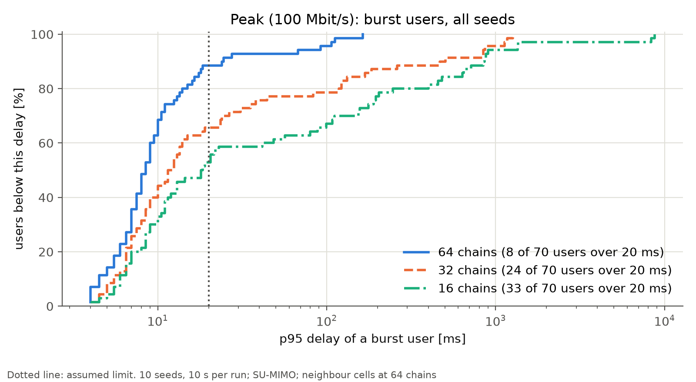

At peak, 32 and 16 chains leave 24 and 33 of 70 burst users over 20 ms, against 8 with 64 chains. At
night no user exceeds the limit; by day 2, 2 and 4 of 100. So the best setting is 16 chains + symbol at
night (-32.1% against 64 chains always on) and by day (-31.6%), and 64 chains + symbol at peak (-7.1%).

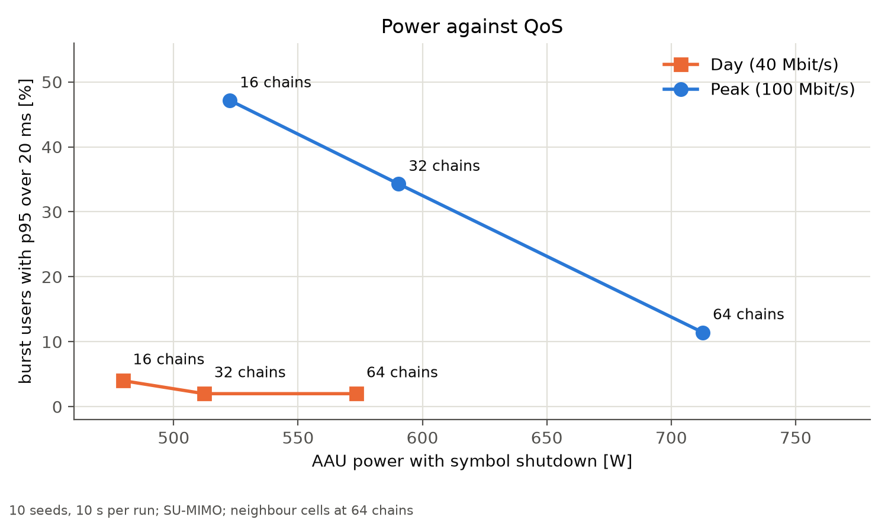

## 3. One day and the deeper sleep modes

Switching off all carriers or putting the AAU in deep dormancy at night would reach -32% and -39%, but
these come from the formula only: there is no wake-up time and the traffic moved to 4G is not
simulated. Symbol + channel gives -27.3% with 6, 8 or 10 hours of night; what moves it is the number
of peak hours, from -29.5% with 2 h to -25.1% with 6 h.

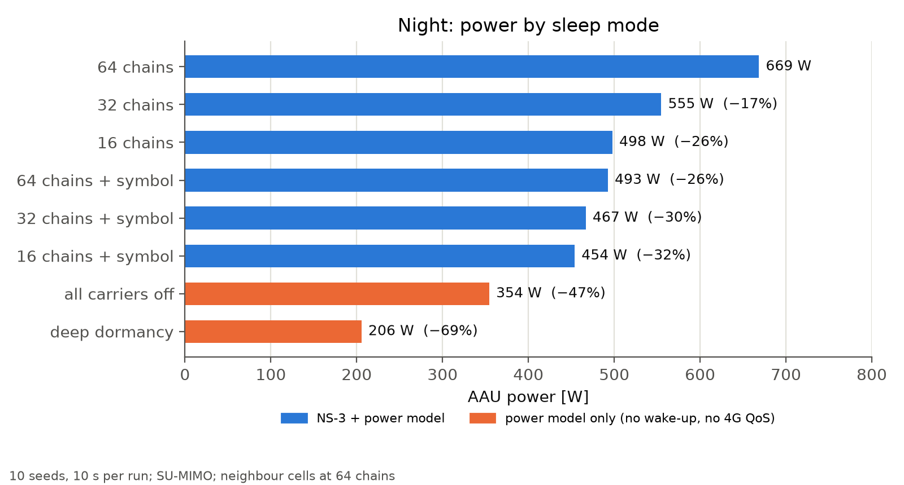

## 4. Energy efficiency

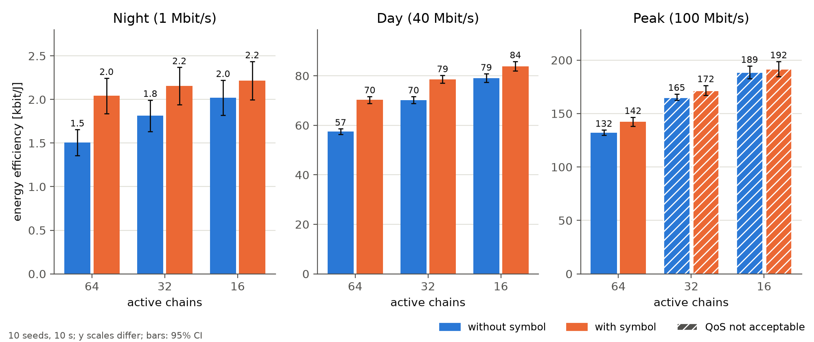

Delivered bits per joule rise most at night and by day (+46% to +47%). At peak, 32 and 16 chains look
more efficient but fail the QoS criterion. Over a day: 53.3 -> 73.3 kbit/J (+37.4 ± 0.8%).

## 5. Other power models: EARTH and Björnson

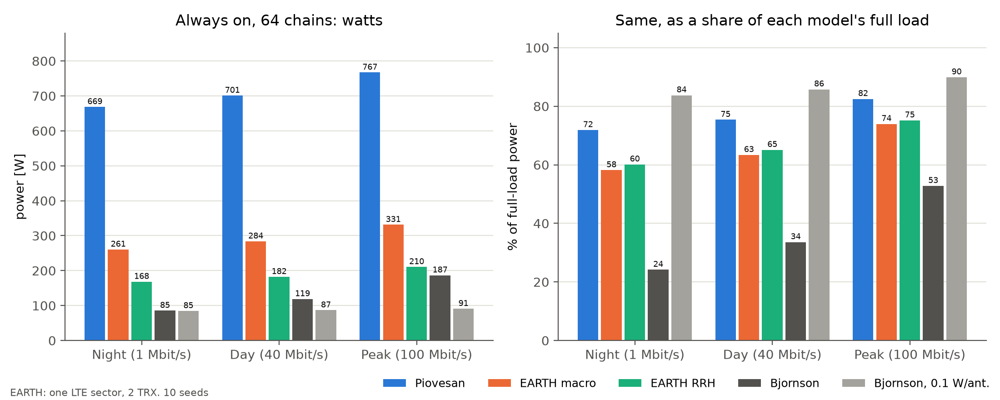

The same NS-3 load in the EARTH model (Auer et al. 2011, an LTE sector) and in the massive-MIMO model of
Björnson et al. (2015). Idle power as a share of full load: Piovesan 72%, EARTH 58-60%, Björnson 24%
with our transmit power or 84% with the paper's 0.1 W per antenna. The 2.5x overestimate of Björnson
mentioned by Piovesan is not reproduced with the parameters in Björnson's Table II: here it gives 4-8
times fewer watts. Which model is "most load-proportional" depends on that transmit-power choice.

## 6. Sleep with a wake-up time

A first estimate replayed the slot traces of the main campaign with an ideal sleep controller
(`studies.wakeup`):

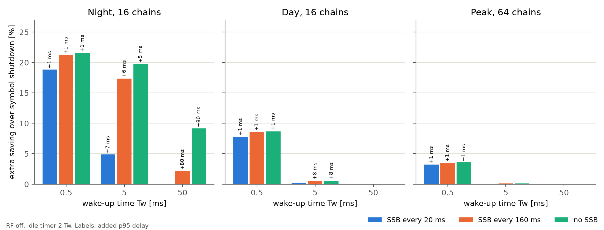

It was then simulated in NS-3 (`run_wakeup.sh`, 70 runs): a sleep controller holds new data while the AAU
sleeps, wakes it up after Tw, waits for pending HARQ feedback and keeps the SSB (synchronisation block)
schedule. No data was ever sent while asleep (0 violations).

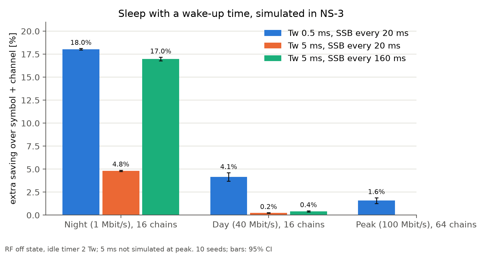

With Tw = 0.5 ms the AAU sleeps 82% of the night and saves another 18% on top of symbol + channel, at
the cost of about 1 ms of p95 delay. With Tw = 5 ms it barely sleeps unless the SSB comes every 160 ms.
The trace estimate was optimistic (it ignored the wait for HARQ feedback): 11.01 against 11.30 kWh.

## 7. Busier nights

Our night carries 1% of the peak traffic; EARTH's daily minimum of active users is 14% of its maximum.
Nights at 5, 10 and 15 Mbit/s were simulated (150 runs, `studies.night`).

Symbol + channel keeps its -32% at all four loads. The extra saving of sleep falls from 18% to 11%
(Tw 0.5 ms) and from 17% to 4% (Tw 5 ms). Over a day: -31.2% at 1 Mbit/s, -29.7% at 15 Mbit/s.

## 8. TDMA against OFDMA

OFDMA shares the band of a slot among users in frequency and fills almost every symbol, even for small
data. TDMA gives each user whole symbols over the full band and stops when the data fits, which leaves
more empty symbols for the PAs. The same 90 runs were repeated with TDMA in all sites (`studies.tdma`).

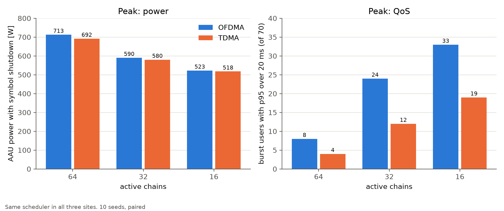

At peak, TDMA lowers the power with symbol shutdown by 21 W at 64 chains and halves the users over
20 ms (8 -> 4, 24 -> 12, 33 -> 19). By day and at night it changes little, since the saving there comes
from slots that are empty with either scheduler. Over a day: -28.0% instead of -27.3%. The best setting
does not change.

## 9. Why TDMA serves the peak better

A 2 x 2 campaign (`studies.mix`, 120 runs) set the scheduler of cell 0 and of its neighbours
independently and traced every transport block received in cell 0.

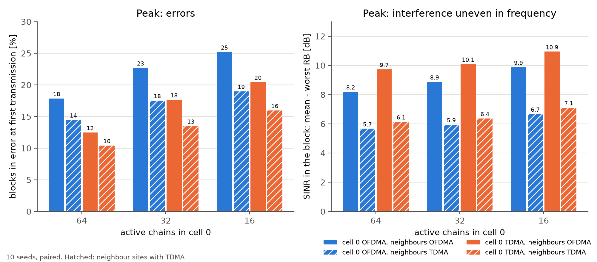

The mean SINR and the chosen MCS barely change. What changes is the share of blocks received in error at
the first transmission (10-25%), and the error model of 5G-LENA predicts these rates exactly. Two
separate effects, averaged over the other factor:

- **TDMA in the neighbours** makes their interference flat across frequency. The gap between the mean
  SINR of a block and its worst resource block shrinks by about 3 dB, and errors drop by 2.7-5.3 points.
- **TDMA in cell 0** lowers errors by 3.9-4.7 points although that gap grows slightly, so the cause is
  different and is **not verified**. It is not a choice of sub-bands: with the default wideband MCS,
  OFDMA assigns resource blocks in order. A candidate is that the MCS is computed on the whole band, which
  a TDMA block uses and an OFDMA block does not; TDMA blocks are also shorter (9.4 against 12.5 symbols).

Fewer retransmissions mean shorter queues. The power saving comes mostly from cell 0 (-15.9 W at 64
chains, against -4.8 W from the neighbours).

## 10. The 3GPP power model

Steps 3 and 6 pair sleep times from a survey with sleep powers from Piovesan. 3GPP TR 38.864 (V18.1.0,
clause 5.1), the study on network energy saving for NR, gives both in one model, for a reference
configuration close to ours (TDD, 100 MHz at 30 kHz, 64 transmit chains). Powers are relative to deep
sleep (= 1). The report gives two alternative sets of values, Category 1 and Category 2, without saying
which equipment they stand for:

| State | Category 1 | Category 2 | Total transition time (down + up), Cat. 1 / Cat. 2 |
|---|---|---|---|
| Active DL, full load | 280 | 32 | - |
| Active UL | 110 | 6.5 | - |
| Micro sleep | 55 | 5.5 | immediate |
| Light sleep | 25 | 2.1 | 6 ms / 640 ms |
| Deep sleep | 1 | 1 | 50 ms / 10 s |

While transmitting, the power of a symbol is

$$
P_{\mathrm{DL}} = P_{\mathrm{micro}} + s_a\,A\,(P_{\mathrm{DL,max}} - P_{\mathrm{micro}}) + \frac{s_f\,s_p}{\eta}\,(1-A)\,(P_{\mathrm{DL,max}} - P_{\mathrm{micro}}),
\qquad A = 0.4
$$

with $s_a$ the share of active chains, $s_f$ the share of the 100 MHz band in use, $s_p$ the power spectral
density per chain against the reference and $\eta$ a factor for the PA efficiency. A second contiguous
carrier costs 0.7 times the first, and each light or deep sleep adds a transition energy. `studies.threegpp`
builds this power symbol by symbol from the same NS-3 traces. Empty symbols drop to micro sleep with symbol
shutdown. Assumptions: the control symbol uses the whole carrier, UL symbols are always receiving, and
the 0.7 factor also applies to sleep states. $s_p = 1$, the reference density; scaled to our radiated power
(104.9 W over 60 MHz, against 55 dBm over 100 MHz) it would be about 0.55. $\eta = 1$, the single value the
report allows for any $s_f$ and $s_p$; it also allows 0.76 when $s_f s_p < 0.5$, which with our 30 MHz carriers
is always the case. Both are declared in `lib/power.py` (`TGPP_SP`, `TGPP_ETA`).

The savings nearly double: an empty symbol costs 20% of full load in the 3GPP model against 47% in
Piovesan, which was fitted on today's commercial hardware. Light and deep sleep were first estimated on the
traces, then simulated in NS-3 for Category 1 (50 runs, wake-up time = half of the transition time):

- light sleep at night adds 30.0% with an SSB every 20 ms and 52.2% with one every 160 ms, with no user
  over 20 ms; by day it adds 4.4% and at peak 1.4%, within the QoS criterion;
- deep sleep at night adds 49.5%, less than light sleep, and puts every night burst user over 20 ms;
- deep sleep needs 50 ms, which does not fit between SSBs 20 ms apart. Category 2 transitions (640 ms
  and 10 s) fit only without any SSB, and its deep sleep is longer than the simulated window.

## 11. A policy that picks the chains by itself

The best settings of step 2 assume someone knows the traffic level. Here a simple rule decides alone:
every 5, 15 or 60 minutes it looks at the load just measured, adds a safety margin (0, 25, 50 or 100%) and
keeps the fewest chains that sustain that load for the next interval. Two arrays were added to the scenario,
48 (6 x 8) and 24 (4 x 6) chains, and the day profile was simulated from 5 to 100 Mbit/s every 10 Mbit/s
at all five chain counts (560 runs, `bs-results-grid`).

| Chains | QoS acceptable up to | Power at 100 Mbit/s with symbol shutdown |
|---|---|---|
| 16 | 40 Mbit/s | 526 W (fails) |
| 24 | 50 Mbit/s | 563 W (fails) |
| 32 | 50 Mbit/s | 599 W (fails) |
| 48 | 100 Mbit/s | 662 W |
| 64 | 100 Mbit/s | 723 W |

48 chains sustain the whole peak, so 64 are almost never needed; 32 are never chosen, since 24 sustain the
same load for less. The rule was tested on 300 simulated days of 5-minute loads: our 8/12/4 h levels with
one-hour ramps, times a random log-normal fluctuation (σ = 0.25, correlated between steps). Each step uses
the power and QoS of the 10 s runs at its load, and switching chains is taken as instantaneous.

| Policy | Saving, Piovesan | Saving, 3GPP Cat. 1 | Time with QoS not acceptable |
|---|---|---|---|
| 64 chains + symbol, no decision | 18.9% | 39.1% | 0 |
| Oracle (knows the load of each step) | 27.6% | 48.5% | 0 |
| Every 5 min, margin 50% | 24.0% | 45.3% | 0.04% |
| Every 5 min, margin 100% | 22.8% | 44.1% | 0 |
| Every 15 min, margin 100% | 22.8% | 44.1% | 0.05% |
| Every 60 min, margin 100% | 23.1% | 44.2% | 1.2% |

Without a margin the rule saves as much as the oracle but leaves the QoS unacceptable 7-16% of the time,
every day: the load rises within the interval. Deciding every 5-15 minutes with a wide margin keeps about
23-24% with almost no violation; deciding every hour is too slow. The intermediate arrays add 2-3 points
compared with a choice among 64, 32 and 16 only (oracle 24.2%, 5 min with 50% margin 21.4%). Taking the
100 Mbit/s point from the peak profile with video instead of the day profile (`--peak`) changes no
acceptable load and no saving by more than 0.1 points.

## 12. All sites with fewer chains

Until here only cell 0 saved energy and its neighbours kept 64 chains. In a real network all sites would switch
off chains together, and with fewer chains each neighbour transmits less power (each PA keeps its own maximum), so
cell 0 sees less interference. The main campaign was repeated with the neighbours at the same number of chains as
cell 0 (60 runs, `studies.allsites`); 64 chains are the same runs in both cases.

| Level | Chains | Neighbours | Saving, symbol shutdown | Burst users over 20 ms | Late video segments | SINR at peak | First-transmission errors |
|---|---|---|---|---|---|---|---|
| Night | 16 | 64 / same | 32.1% / 32.1% | 0 / 0 of 20 | - | - | - |
| Day | 16 | 64 / same | 31.6% / 31.7% | 4 / 3 of 100 | - | - | - |
| Peak | 64 | 64 | 7.1% | 8 of 70 | 2 | 35.8 dB | 15.9% |
| Peak | 32 | 64 / same | 23.1% / 23.8% | 24 / 12 of 70 | 6 / 3 | 30.0 / 31.1 dB | 20.2% / 17.7% |
| Peak | 16 | 64 / same | 31.9% / 32.6% | 33 / 13 of 70 | 13 / 8 | 25.3 / 27.3 dB | 22.5% / 19.1% |

At night and by day nothing changes: the neighbours are almost silent. At peak, neighbours with fewer chains
raise the SINR in cell 0 by 1-2 dB, cut the errors by 2.5-3.4 points and halve the users over 20 ms, but 32
and 16 chains still fail the QoS criterion (+5.7 and +7.1 points of users over 20 ms, and extra late segments).
So the best setting per level does not change, and the results of the earlier steps, with neighbours at 64,
are slightly pessimistic for the QoS at peak. The SINR and errors with neighbours at 64 come from the mix
campaign of step 9, whose OFDMA runs are identical to the main ones.

## 13. Final study: every cell picks its own chains

In a real network each cell would choose its chains from its own traffic. The scenario got one more option,
`--neighborLoadMbps` (burst load of the other sites, separate from cell 0), and `run_campaign.sh` can give each
neighbour the chains that a rule picks for the neighbour's own load (`NEIGHBOR_CHAINS=rule`; the rule is the one of
step 11: 16 chains up to 40 Mbit/s, 24 up to 50, 48 up to 100, 64 above). Cell 0 ran every chain count at every
load, with 1890 runs in `bs-results-indep` (`studies.final`):

- neighbours at the same load as cell 0: night and 5-150 Mbit/s every 10, 64/48/32/24/16 chains, 10 seeds,
  20 seeds for 64/48/32 chains at 80-150 Mbit/s, where the QoS decision was closest;
- neighbours at half and at twice the load of cell 0 (at most 150 Mbit/s): 10, 20, 40, 60, 80, 100, 120 and
  150 Mbit/s, 10 seeds.

The day profile is used throughout (10 burst users per site, no video).

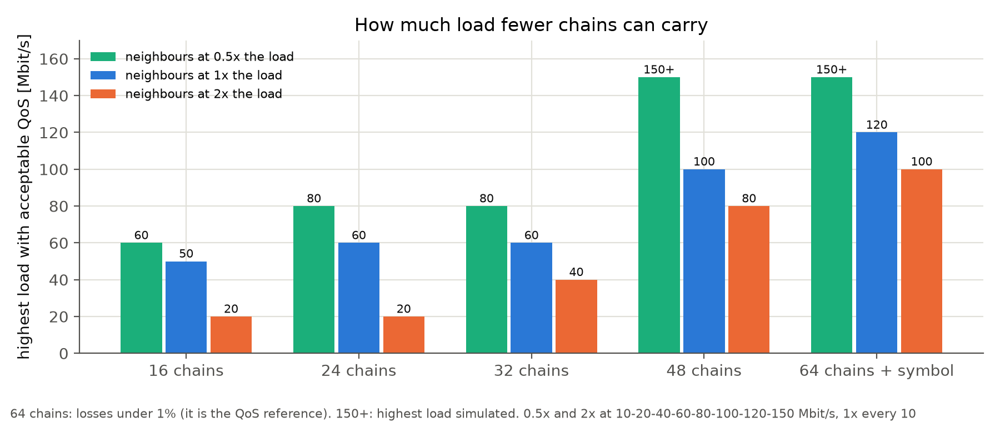

| Chains of cell 0 | Neighbours at 64 (step 11) | Neighbours at 0.5x | **Same load (1x)** | 2x |
|---|---|---|---|---|
| 16 | 40 | 60 | **50** | 20 |
| 24 | 50 | 80 | **60** | 20 |
| 32 | 50 | 80 | **60** | 40 |
| 48 | 100 | 150+ | **100** | 80 |
| 64 + symbol (losses under 1%) | 100+ | 150+ | **120** | 100 |

Highest load with acceptable QoS, Mbit/s; "+": no failure up to the highest load simulated. At 0.5x and 2x only
eight loads were simulated, so those limits are lower bounds.

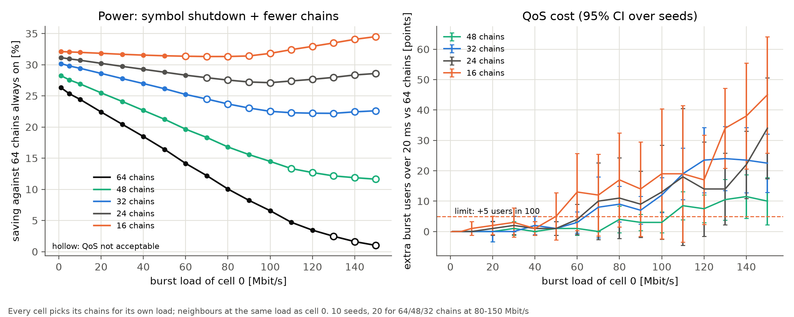

- **Neighbours that save too let cell 0 save more.** At the same load, 16 chains are acceptable up to 50 Mbit/s
  instead of 40, and 24 or 32 up to 60 instead of 50: lightly loaded neighbours use fewer chains and interfere less.
- **The neighbours' load matters as much as one's own.** With neighbours twice as loaded, 16 chains carry only
  20 Mbit/s; with neighbours half as loaded, 48 chains carry 150.
- **32 chains are rarely worth it**: with neighbours at the same or half the load they carry the same load as 24
  for 2-3 points less saving; only with neighbours twice as loaded do they carry more (40 Mbit/s against 20).
- **Above 120 Mbit/s the cell is saturated**: even 64 chains lose over 1% of the packets.
- **More seeds settle the 48-chain limit.** With 20 seeds the 95% CI of the extra users over 20 ms at 48 chains,
  80-110 Mbit/s, is 2.7-4.6 points: +3.0 ± 3.4 at 100 Mbit/s (acceptable), +8.5 at 110 (not). The 16-chain limit at
  50 Mbit/s is exactly on the criterion (+5.0 ± 7.7 points, 10 seeds) and could be 40 with other seeds.
- **The rule is consistent with what it produces.** The neighbours used the step 11 rule, which is more cautious
  than the limits measured here, so between 40 and 60 Mbit/s they kept more chains than needed. Fewer chains in the
  neighbours mean less interference in cell 0 (step 12), so the limits above are lower bounds and no rerun is needed.
- **The criterion is relative.** From about 90 Mbit/s even 64 chains degrade: 11% of the burst users over 20 ms at
  90 Mbit/s, 22% at 120, 51% at 150. "Acceptable" means "not much worse than 64 chains".

**One day (step 3 again).** Night and day come from this campaign (neighbours at the same load). The peak keeps the
profile with video of the main campaign, with neighbours at 64: this campaign has no video, and neighbours that also
save would only lower the interference. At peak 48 chains are acceptable (+4.3 points of users over 20 ms, no extra
late segment; step 11), so the best settings become 16 chains at night and by day, 48 at peak.

| Policy (hours 8/12/4) | Energy per day | Saving, Piovesan | Saving, 3GPP Cat. 1 |
|---|---|---|---|
| Always on | 16.81 kWh | - | - |
| Symbol shutdown | 13.64 kWh | 18.9% | 38.8% |
| Symbol + channel, 64 at peak (steps 2-3) | 12.23 kWh | 27.3% | 48.0% |
| **Symbol + channel, 48 at peak** | **12.00 kWh** | **28.6 ± 0.4%** | **49.1%** |
| ... + sleep at night, 0.5 ms wake-up (NS-3) | 11.35 kWh | 32.5% | |
| ... + 3GPP light sleep at night (SSB every 160 ms) | | | **56.6%** |
| ... + all carriers off at night (power formula only) | 11.21 kWh | 33.4% | |
| ... + deep dormancy at night (power formula only) | 10.02 kWh | 40.4% | |

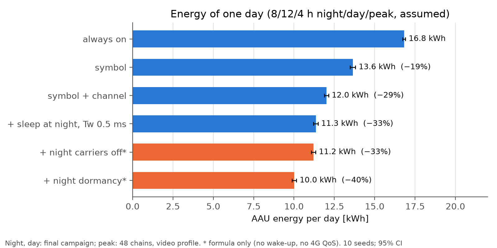

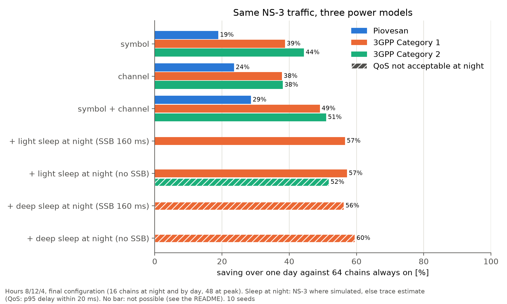

The night and day powers are within 0.5 W of the main campaign (453.9 and 479.1 W with 16 chains): the gain comes
from the peak. The sleeping nights are the NS-3 simulations of steps 6 and 10, whose neighbours are at 64; at 1 Mbit/s
the neighbours make no difference. With sleep at night the night delays grow by 0.25 ms (median of the users' p95,
6.0 to 6.25 ms) and no user goes over 20 ms.

**The policy (step 11 again)** on the same 300 days, with the limits measured here and loads up to 150 Mbit/s
instead of 100 (`studies.policy --final`).

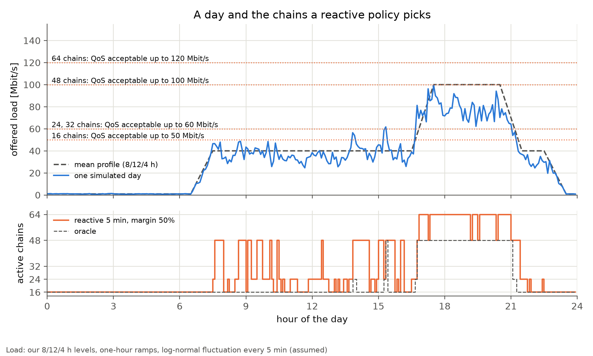

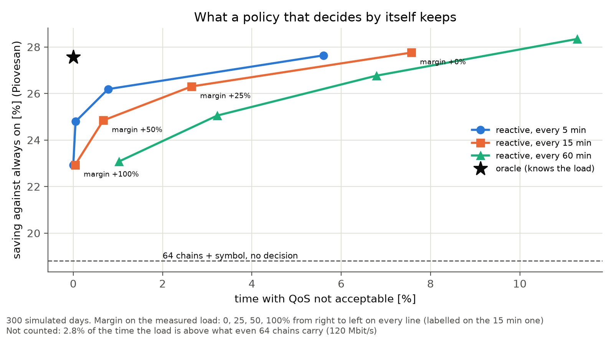

| Policy | Saving, Piovesan | Saving, 3GPP Cat. 1 | Time with QoS not acceptable | Step 11 |
|---|---|---|---|---|
| 64 chains + symbol, no decision | 18.8% | 38.8% | 0 | 18.9% |
| Oracle | 27.6% | 48.4% | 0 | 27.6% |
| Every 5 min, margin 50% | **24.8%** | 45.9% | 0.05% | 24.0%, 0.04% |
| Every 5 min, margin 100% | 22.9% | 44.1% | 0 | 22.8% |
| Every 15 min, margin 100% | 22.9% | 44.0% | 0.04% | 22.8%, 0.05% |
| Every 60 min, margin 100% | 23.1% | 44.0% | 1.0% | 23.1%, 1.2% |

The rule gains almost a point at the same QoS. The oracle does not move: it uses 16 chains for longer, but the
loads above 100 Mbit/s, clipped before, now count. 2.8% of the time (about 40 minutes a day, at peak) the load is
above 120 Mbit/s and not even 64 chains give acceptable QoS; that time is not counted as a fault of the policy.

